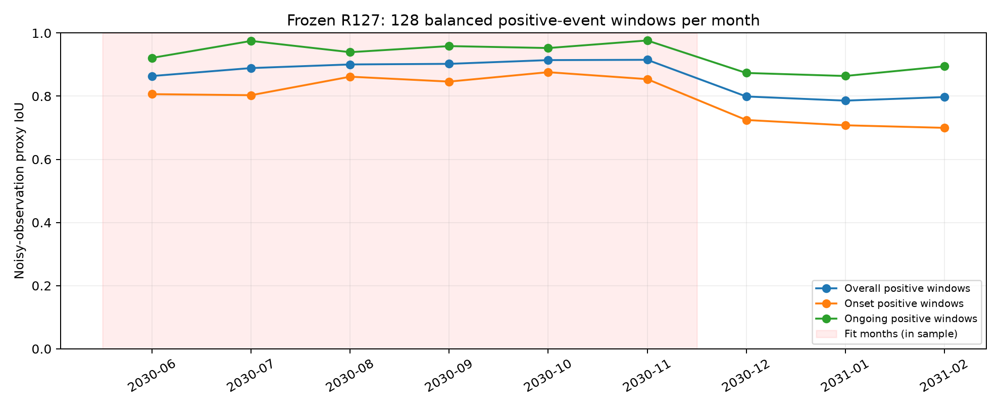
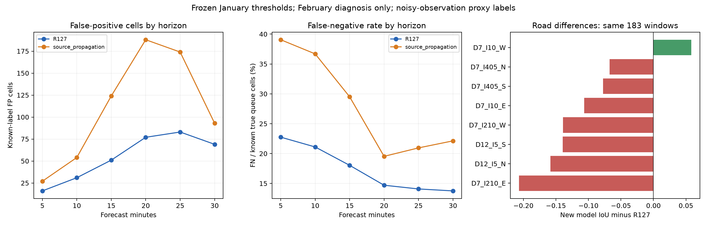

# Task 2 当前最佳确认与审计（2026-10-29）

当前继续采用 **R127 ConditionalPosition**。本次确认没有重新训练、替换权重、修改道路策略或重新选择阈值。Onset门槛 `.50`、Ongoing门槛 `.25`；完整模型的1214个冻结文件再次校验通过。

## 下载并运行最佳模型

[完整推理权重与精确训练输入 Release](https://github.com/OscarZH2005030/25-day-a-Big-Dream/releases/tag/task2-r127-repro-20261027) · [安装、推理、评分重算与重训命令](../../README.md)

采用原 `ConditionalPosition-R127.zip`，SHA256：

```text
c90229ea2df8215ffe18c52de910b1c32735d569257e36b076b0c3e9e3f07649
```

原始竞赛数据从Kaggle授权下载；本次没有将原始数据、本机运行环境或未胜出的候选权重加入仓库。

## 采用模型的成绩

| 固定二月人口 | 全部正例窗口 | 整体代理IoU | Onset窗口数 | Onset代理IoU | Ongoing代理IoU |
|---|---:|---:|---:|---:|---:|
| 新版 | 367 | 0.7959762085498983 | 183 | 0.7320598420153661 | 0.8598925750844304 |
| 旧版 | 410 | 0.7545993040930380 | 200 | 0.7301012853729876 | 0.7790973228130884 |

这两套窗口不同，分别报告，不混合或择优拼接道路。二月此前已多次用于开发；这些不是独立盲测、全年平均或Kaggle官方成绩。官方 `queue_true` 在所有划分均未公开，`official_S_queue=null`。公开速度阈值构造的标签带有观测噪声，不能当作底层模拟真值。

一月固定后，最近的候选比较如下（同一批183个二月正例Onset窗口）：

| 方法 | Onset代理IoU | 误报cell | 漏报cell |
|---|---:|---:|---:|
| 采用：R127 | 0.7320598 | 327 | 467 |
| R127锚定强负例残差，完整启用 | 0.7155628 | 270 | 557 |
| 选择性门控残差 | 0.7317403 | 326 | 468 |
| 独立源定位→传播生成 | 0.6274497 | 660 | 736 |
| 源模型关闭未来传播的匹配对照 | 0.6331151 | 868 | 613 |

残差按原一月规则选择出的启用强度为0，实际采用结果仍等于R127；上表完整启用仅作诊断。独立两阶段MLP同样未超过R127。旧版门控约+0.00003的变化没有稳定统计证据，不认定为新最佳。

## 月度审计应怎样读

[monthly_comparison.csv](monthly_comparison.csv)每月128个冻结清单正例窗口，按固定SHA256抽取八方向、两种条件各8个，六月至二月共1152个；该抽样与上方原二月367/410窗口不同。

- 2030年6—11月用于训练，分数是训练期成绩。
- 2030年12月用于选择模型/道路策略，2031年1月用于校准。
- 2031年2月是已经反复查看过的开发后评估。
- 2031年3、4月各80个官方窗口已预测；各87,000行输出与原Release预测逐位比较结果见 [publication_verification.json](publication_verification.json)。没有公开真值，无法在本机报告IoU、误报或漏报。
- 2031年5月没有发布数据。整个发布覆盖11个月，不存在本次可报告的12个月成绩。

另有6552个固定时刻窗口（所有273天、八方向、每日06:00/12:00/18:00 UTC），保留安静时段以检查自然误报，见 [fixed_clock_monthly_comparison.csv](fixed_clock_monthly_comparison.csv)。这组固定时刻没有覆盖部分道路的Onset正例，不能把其缺组的诊断IoU当成完整Task 2分数；不能与正例基准混算。



## 为什么后续模型未替换最佳

源传播模型在相同384个训练期Onset窗口上只有0.6621，R127为0.8412；基本拟合能力就存在差距。它的源头分支还混入了持续排队，Noisy-OR生成器又不能否决已经报高的源头概率。二月新增错误同时涉及链路支持和时间边界，而非单一门槛偏差。

[详细错误分析](failure_analysis.txt)、[各道路对比](road_comparison.csv)、[各预测时距](per_horizon_errors.csv)、[错误分解](decomposition.json)保存了证据。源标签是可观测图上的弱代理，不能声称已经标注或定位真实物理瓶颈。时间误差只在完整标签且被检出的子集计算，有选择偏差。



## 校验

在本目录运行：

```bash
python verify_audit.py
```

仅使用Python标准库，检查本目录文件SHA256、已采用模型与原固定指标的一致性、九个月完整正例分组、6552个日常窗口、160个官方推理窗口，以及后续六个候选模型的未修改记录。完整最佳权重校验和分数重算请按上层复现指南执行。

本次未向Kaggle提交，Task 1没有改动。
